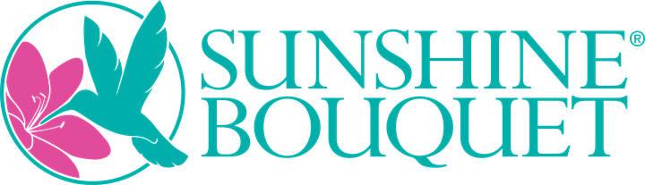

# Equipo de agentes — plugin `equipo`

> **Para quién es:** para quien desarrolla en los proyectos de `C:\Source` con Claude Code.
> **Qué hace:** pone a trabajar un equipo de agentes con un mismo método en todos los proyectos: tests primero, revisión independiente, documentación al día y commit.
>
> Última revisión: 2026-10-23.

---

## 0. ¿Qué es esto?

Un plugin de Claude Code con tres cosas:

1. **Un método de trabajo** (`/desarrollar`): cada cambio pasa por plan → tests que fallan → implementación → revisión en paralelo → documentación → commit.
2. **Un equipo** de agentes especializados que el método llama solos.
3. **Guardarraíles** (hooks) que no dejan terminar con tests rojos y formatean el código.

Vive en un repo propio para que funcione **en cualquier proyecto y en cualquier worktree** (lo que está en `C:\Source\.claude` deja de verse en cuanto un proyecto tiene su propio git).

### El equipo

| Agente | Qué hace |
|---|---|
| `escritor-tests` | Escribe los tests desde los criterios de aceptación y confirma que fallan por la razón correcta. Solo toca `tests/`. |
| `documentador` | Manuales de usuario/administrador con el estilo de Conteo Rosas: paso a paso, paleta Sunshine, capturas con marcas numeradas. |
| `rigor-numerico-scout` | Audita baseline, leakage, métrica, reproducibilidad (solo lee). |
| `project-scout` | Mantiene el nodo del proyecto en el grafo de conocimiento. |

Además usa los integrados `Explore`, `Plan` y la skill `code-review`.

### Las skills

| Skill | Para qué |
|---|---|
| `/desarrollar <tarea>` | El ciclo completo de una tarea. |
| `/preparar-proyecto <carpeta>` | Incorpora un proyecto: git, `.gitignore`, `AGENTS.md` + `CLAUDE.md`, deps de desarrollo, permisos, commit inicial. |
| `/documentar <proyecto> [usuario\|admin\|readme]` | Manuales vía el `documentador`. |
| `/revisar-rigor-matematico` | Auditoría de rigor. |
| `/nuevo-proyecto`, `/actualizar-grafo`, `/ver-grafo`, `/profundizar-proyecto` | Grafo de conocimiento de `C:\Source`. |
| `protocolo-matematico`, `estilo-documentacion` | Conocimiento de referencia que precargan los agentes. |

---

## 1. Instalar (una vez por PC)

```powershell
claude plugin marketplace add C:\Source\equipo-agentes
claude plugin install equipo@equipo-agentes
```

Reinicia Claude Code. ✅ **Listo cuando** `/agents` muestra `escritor-tests` y `documentador`.

> 💡 **Tip:** el plugin se lee directo de esta carpeta: lo que edites aplica en la siguiente sesión (o con `/reload-plugins`), sin reinstalar.

## 2. Activar los hooks (cuando estén autorizados)

Los hooks son scripts `.ps1` y el antivirus corporativo bloquea los `.ps1` nuevos (ni siquiera deja leerlos). Por eso vienen **desactivados**: `plugins/equipo/hooks/hooks.pendiente.json`.

1. Pide autorización para `plugins/equipo/hooks/verificar-tests.ps1` y `plugins/equipo/hooks/formatear.ps1`.
2. Renombra `hooks.pendiente.json` → `hooks.json`.
3. Abre una sesión nueva (o `/reload-plugins`).

✅ **Listo cuando** un turno con un test roto no puede terminar y Claude dice *"Los tests fallan (pytest exit 1)…"*.

> ⚠️ **Cuidado:** si activas los hooks sin autorización, verás un error de hook en cada turno.

## 3. Trabajar en un proyecto

1. Abre la sesión **con la carpeta del proyecto** como directorio de trabajo (no `C:\Source`).
2. Si el proyecto no tiene git ni `AGENTS.md`: `/preparar-proyecto`.
3. Cada tarea: `/desarrollar <qué quieres>`.
4. Manuales: `/documentar <proyecto> usuario`.

## 4. Compartir con otra persona

Pásale esta carpeta (o súbela a un repo git). Ella hace el paso 1 con su ruta. Las skills del grafo asumen `C:\Source`; el resto funciona en cualquier carpeta.
